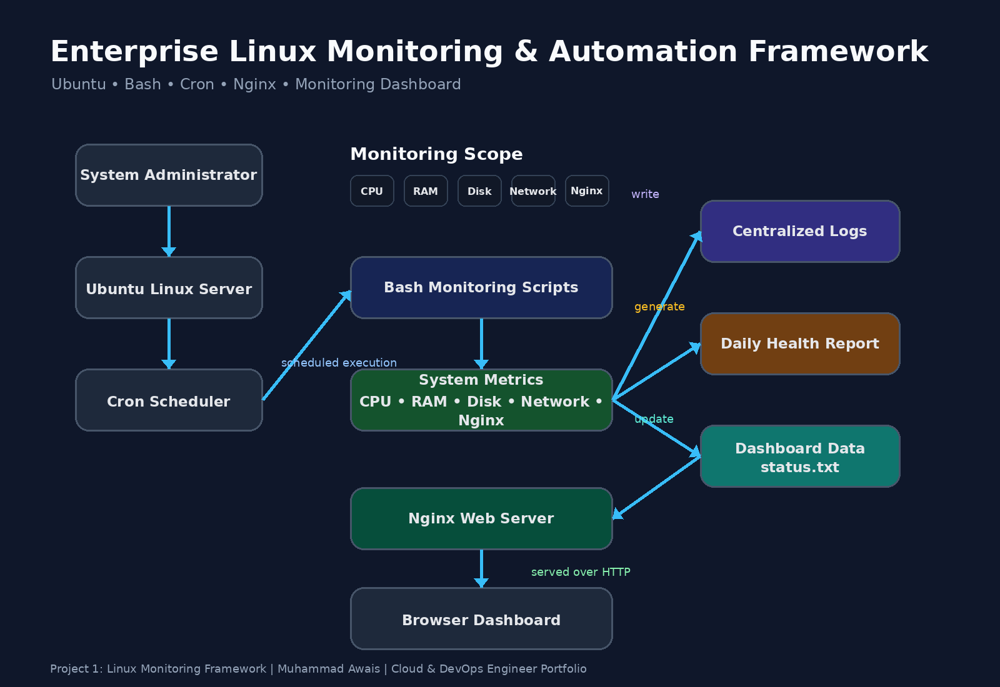
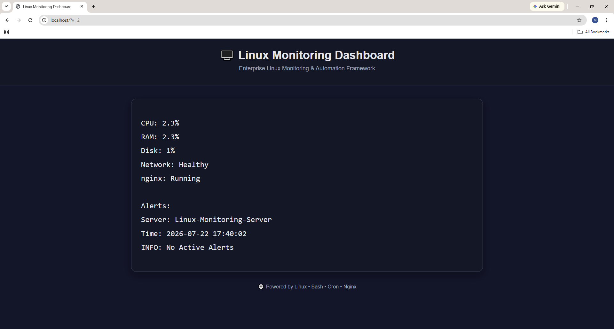
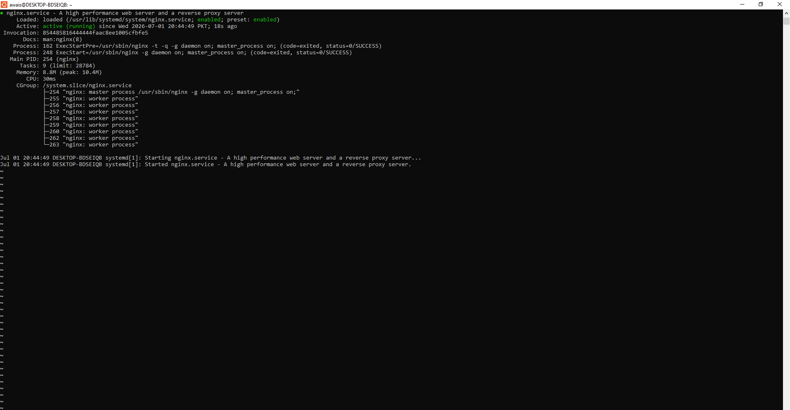
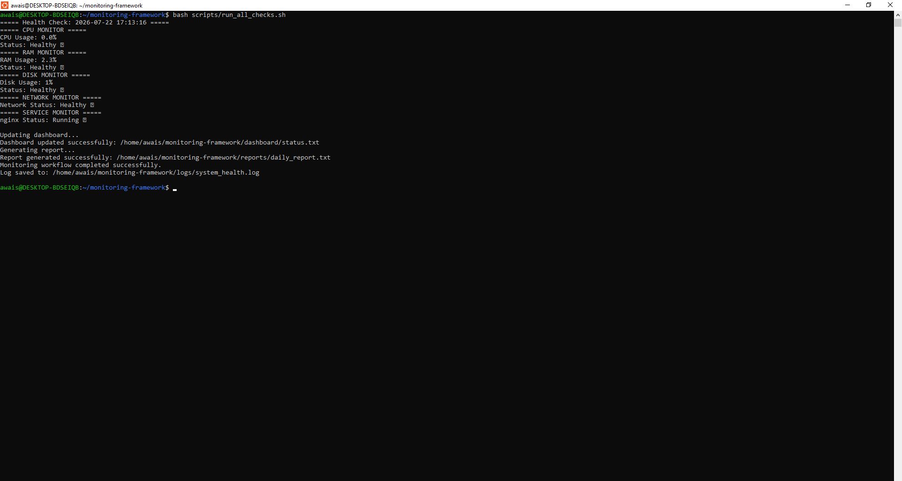
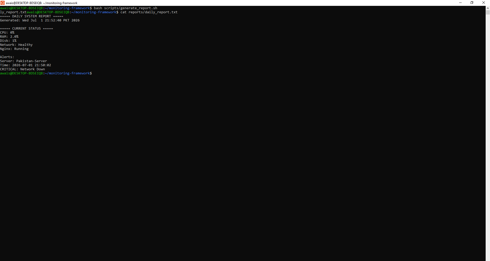
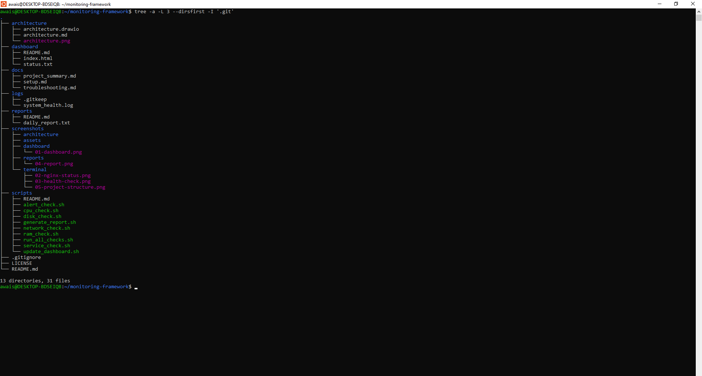

# 🚀 Enterprise Linux Monitoring & Automation Framework

> A production-inspired Linux monitoring and automation framework built with **Ubuntu**, **Bash**, **Cron**, and **Nginx** to automate system health checks, centralized logging, report generation, and a web-based monitoring dashboard.

---

## 📌 Project Highlights

- 🐧 Ubuntu Linux
- 📜 Bash Scripting
- ⏰ Cron Automation
- 🌐 Nginx Web Server
- 📊 HTML Monitoring Dashboard
- 📄 Automated Report Generation
- 📝 Centralized Logging
- 🚨 Automated Alert Detection


---

## 🏗️ Architecture  Diagram




**Figure 0:** Enterprise Linux Monitoring & Automation Framework architecture showing the complete workflow from system administration and monitoring scripts to logging, reporting, dashboard generation, Nginx, and browser access.

---


## 📷 Dashboard Preview



**Figure 1:** Live Linux Monitoring Dashboard displaying CPU, RAM, Disk, Network, Nginx status, alerts, and server health.

---
## 📷 Nginx Service Status


**Figure 2:** Nginx service running successfully on Ubuntu Linux. During each scheduled monitoring cycle, the framework automatically verifies that the Nginx web server is running and available before updating the dashboard, generating reports, and recording execution logs.

---
## 📷 Health Check Execution



**Figure 3:** The monitoring framework executes all health check scripts in a single run, validating CPU, RAM, Disk, Network, and Nginx service status before updating logs, reports, and the monitoring dashboard.

---

### Daily Report




**Figure 4:** The monitoring framework automatically generates a system health report after each monitoring execution. When scheduled through Cron, the report can be generated at any desired interval, including daily, providing operational visibility and supporting troubleshooting.


---

## 📷 Project Structure



**Figure 5:** Organized project structure showing separation of scripts, dashboard, documentation, reports, architecture, and screenshots following engineering best practices.

## 📚 Documentation

- 📐 [Architecture Overview](architecture/architecture.md)
- ⚙️ [Setup Guide](docs/setup.md)
- 🛠️ [Troubleshooting Guide](docs/troubleshooting.md)
- 📊 [Dashboard Documentation](dashboard/README.md)
- 📄 [Reports Documentation](reports/README.md)
- 🖥️ [Scripts Documentation](scripts/README.md)

---


## 🎯 Business Problem

Managing Linux servers manually is time-consuming and error-prone. This project automates system health monitoring, service validation, report generation, and dashboard updates to reduce operational effort and improve visibility across Linux environments.

---

## 🎯 Project Goals

- Automate Linux system monitoring
- Detect service failures automatically
- Generate health reports
- Centralize monitoring logs
- Display server health through a web dashboard


---


## 🛠️ Technology Stack

<p align="left">


</p>


---

## 📂 Project Structure

```text
linux-monitoring-framework/
│
├── architecture/
├── dashboard/
├── docs/
├── reports/
├── screenshots/
├── scripts/
├── logs/
├── LICENSE
├── .gitignore
└── README.md

```

---

## ✨ Features

- ✅ CPU Monitoring
- ✅ RAM Monitoring
- ✅ Disk Usage Monitoring
- ✅ Network Connectivity Checks
- ✅ Nginx Service Monitoring
- ✅ Automated Health Reports
- ✅ Centralized System Logs
- ✅ HTML Dashboard
- ✅ Cron-based Automation
- ✅ Alert Detection
- ✅ Bash Automation Scripts

---

## ⚙️ Installation

### Prerequisites

- Ubuntu 24.04+ or WSL Ubuntu
- Git
- Bash
- Nginx
- Cron
- `awk`, `coreutils`, and `util-linux` (`flock`)
- `procps`
- `iputils-ping`

Install the required packages:

```bash
sudo apt update
sudo apt install -y git nginx cron gawk coreutils util-linux procps iputils-ping
```


### Clone Repository

```bash
git clone https://github.com/awais-clouddev/linux-monitoring-framework.git
cd linux-monitoring-framework
```

### Make Scripts Executable

```bash
chmod +x scripts/*.sh
```
### Run the Monitoring Framework

Run the complete monitoring workflow manually:

```bash
bash scripts/run_all_checks.sh
```

### Schedule Automatic Monitoring with Cron

Open the current user's Cron configuration:

```bash
crontab -e
```

Add the following entry to execute the monitoring framework every five minutes:

```cron
*/5 * * * * /home/USER/linux-monitoring-framework/scripts/run_all_checks.sh
```

Replace `/home/USER/linux-monitoring-framework` with the absolute path of your project.

Verify the Cron job:

```bash
crontab -l
```

Ensure the Cron service is running:

```bash
if [ "$(ps -p 1 -o comm=)" = systemd ]; then
    sudo systemctl enable --now cron
else
    sudo service cron start
fi
```


## ▶️ Usage

### Run All Monitoring Checks

```bash
bash scripts/run_all_checks.sh
```

### Generate Latest Health Report


```bash
bash scripts/generate_report.sh
```


### Open the Dashboard

Start the Nginx service if it is not already running:

```bash
if [ "$(ps -p 1 -o comm=)" = systemd ]; then
    sudo systemctl start nginx
else
    sudo service nginx start
fi
```

For a dedicated local lab, preserve the existing web directory and link the current dashboard:

```bash
# Dedicated local lab: preserve any existing web-root directory.
if [ -e /var/www/html ] && [ ! -L /var/www/html ]; then
    sudo mv -- /var/www/html "/var/www/html.backup.$(date +%Y%m%d%H%M%S)"
fi
sudo ln -sfnT "$(pwd)/dashboard" /var/www/html
```

Open your browser:

```text
http://localhost
```

Nginx now serves the dashboard directly from the project directory, so every update to `dashboard/status.txt` becomes immediately available in the browser.


---

## 🔄 Automation Workflow

The monitoring framework follows this automated workflow:

1. System administrator executes the monitoring framework.
2. Bash scripts collect CPU, RAM, Disk, Network, and Nginx metrics.
3. System metrics are validated and analyzed.
4. Monitoring logs are generated and stored.
5. A system health report is generated after each workflow execution.
6. Dashboard data is updated.
7. Nginx serves the latest dashboard.
8. Users access the monitoring dashboard through a web browser.


The complete workflow is illustrated in the Architecture Diagram above.

## 🖥️ Live Dashboard

The monitoring dashboard provides an up-to-date overview of server health through a lightweight HTML interface served by Nginx.


It displays:

- CPU utilization
- RAM usage
- Disk utilization
- Network connectivity
- Nginx service status
- Current alerts
- Server information
- Last monitoring timestamp

The dashboard is automatically refreshed whenever the monitoring framework executes, providing an up-to-date view of the system.

---

## 🚨 Alert System

The monitoring framework automatically detects abnormal system conditions and records alerts for administrators.

Current alert checks include:

- High CPU utilization
- High RAM utilization
- High Disk utilization
- Network connectivity failures
- Nginx service availability

Alerts are automatically displayed on the monitoring dashboard and included in the generated health report to support faster troubleshooting and operational visibility.


---
## 🌿 Git Version Control

This project follows a professional Git workflow.

Every major milestone—including monitoring scripts, dashboard improvements, documentation, architecture diagrams, and screenshots—is tracked through meaningful Git commits.

The complete development history is available in this repository, providing full traceability of the project's evolution.

---

## 🛠️ Challenges & Solutions

During development, several engineering challenges were successfully addressed:

- Designed a modular Bash scripting architecture for maintainability.
- Configured Nginx to serve a live HTML monitoring dashboard.
- Managed Linux file permissions for secure script execution.
- Automated health report generation and dashboard updates.
- Organized the project into a production-style directory structure.

These improvements enhanced reliability, maintainability, and scalability while providing practical DevOps engineering experience.


---

## 📚 Lessons Learned
This project strengthened my practical experience in:

- Linux system administration
- Bash scripting and automation
- Nginx web server configuration
- System health monitoring
- Git and GitHub version control
- Technical documentation
- Troubleshooting Linux services
- Building production-style project structures

This project reinforced the importance of automation, maintainability, documentation, and modular design in modern DevOps engineering.


---

## 🚀 Future Improvements

Planned enhancements for future versions include:

- Multi-server monitoring
- Email and Slack alert notifications
- Docker container monitoring
- AWS cloud deployment
- Grafana and Prometheus integration
- CI/CD pipeline automation
- Kubernetes deployment
- Historical metrics visualization

These improvements will gradually transform the project into a production-ready monitoring platform.

---

## 👨‍💻 Author

**Muhammad Awais**

Cloud & DevOps Engineer Portfolio

- GitHub: https://github.com/awais-clouddev
- Project: Enterprise Linux Monitoring & Automation Framework

---

⭐ If you found this project useful, consider giving it a star.

## Scope and Reliability

This is an independent, single-host Linux monitoring portfolio project,
tested locally on Ubuntu under WSL. It is not a multi-server monitoring
service. Multi-server collection, external email/Slack notifications and
historical metrics storage remain future work.

- CPU, RAM and disk warnings and alerts trigger at or above their thresholds.
- Thresholds accept numeric values from 0 through 100.
- The main workflow uses a nonblocking lock to skip overlapping executions.
- Dashboard and report updates use unique temporary files, cleanup on exit,
  and atomic replacement within their destination directories.
- Logs rotate before a workflow starts when the existing log reaches
  5 MiB; five archives are retained by default. A single run can exceed
  the size threshold before the next rotation.
- Configure rotation using `LOG_MAX_BYTES` and `LOG_KEEP` (1–99 archives).
- Dashboard alerts reuse the dashboard's CPU, RAM, disk, network and service samples.
  Other standalone checks may collect separate samples.
- CPU collection uses the C locale and the latest of two `top` samples.

Run scheduled and manual full workflows through `scripts/run_all_checks.sh`
to use its execution lock and log rotation. Direct execution of individual
scripts does not acquire the workflow lock.

### Verification Record

Local controlled tests covered threshold boundaries, 54 threshold-validation
cases, lock contention/release, concurrent dashboard/report updates,
temporary-file cleanup after a failed dashboard update, log rotation/retention,
and service checks with simulated systemd and non-systemd environments.

CPU parser fixtures covered spacing, field order, latest-sample selection,
boundary values and invalid output. A real CPU check also ran successfully
on the author's WSL host.

These checks do not establish multi-host operation, external notification
delivery, or production availability. The full workflow passed on WSL, Nginx served status data matching the current dashboard file, and the report matched that file. Automatic Cron execution completed successfully at 17:05 on 15 October 2026. Browser rendering was not separately tested.

## Regression Tests and Failure Handling

See [test instructions](tests/README.md) for the reusable Python and
JavaScript suites.

Missing or invalid numeric metrics fail the affected check. Numeric
comparisons no longer require bc. CPU parsing rejects a malformed latest
sample rather than silently reusing an earlier sample.

Dashboard alerts share numeric, network and service snapshots.
The page reports failed, timed-out and empty requests explicitly.
The page refreshes every 30 seconds; metric collection follows Cron.
A successful request alone does not prove recent collection:
check the displayed monitoring timestamp.

The workflow waits for the logger and returns a nonzero exit code if
logging fails. Reducing LOG_KEEP removes excess numbered archives on
the next workflow execution.

WSL must remain active for scheduled monitoring. Services may need
restarting after WSL restarts without systemd. Screenshots are historical
examples rather than proof of current uptime.
